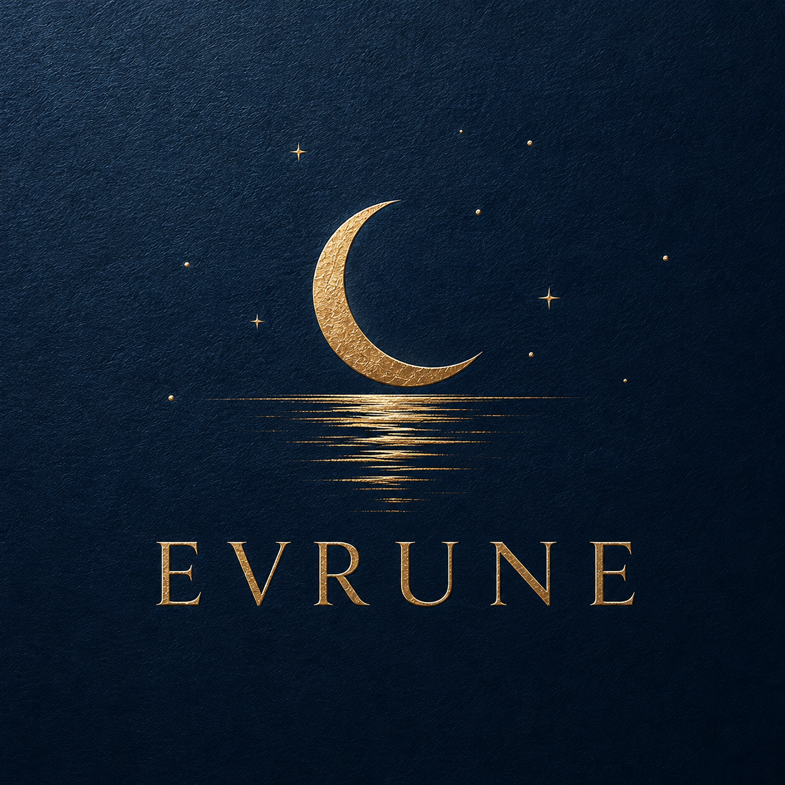
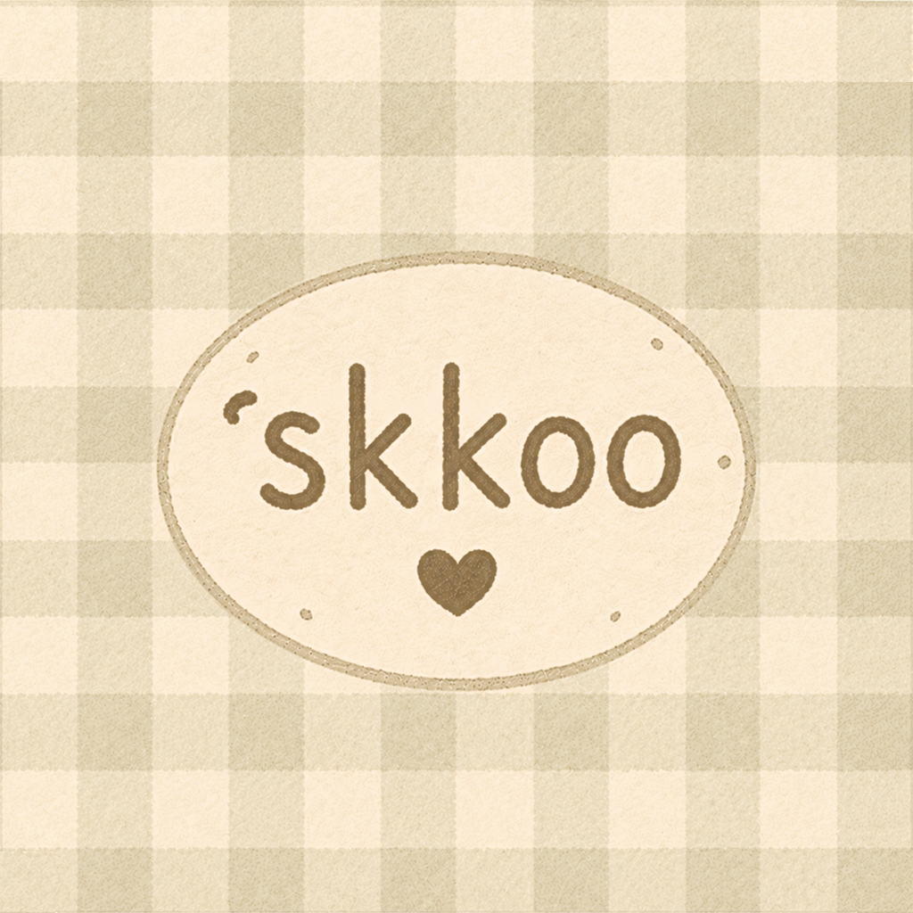

<!-- Top animation only -->

<!-- Animated Tech Icons -->

 

<!-- Static projects heading -->
<h2>📱 PROJECT</h2>

  
  
  
  
  
  
  

 

<!-- Projects Row 1: 4 Apps -->
<table align="center">

<tr>

<!-- Mapary -->
<td align="center" valign="top" width="145">

 
<strong>Mapary</strong>
 

 

&nbsp;

</td>

<!-- Pulto -->
<td align="center" valign="top" width="145">

 
<strong>Pulto</strong>
 

 

&nbsp;

</td>

<!-- EVRUNE -->
<td align="center" valign="top" width="145">

 
<strong>EVRUNE</strong>
 

 

&nbsp;

</td>

<!-- Waesseum -->
<td align="center" valign="top" width="145">

 
<strong>Waesseum</strong>
 

 

&nbsp;

</td>

</tr>

</table>

<!-- Projects Row 2: 3 Apps (Centered) -->
<table align="center">

<tr>

<!-- Tocobi -->
<td align="center" valign="top" width="145">

 
<strong>Tocobi</strong>
 

 

</td>

<!-- TeruBozu -->
<td align="center" valign="top" width="145">

 
<strong>TeruBozu</strong>
 

 

&nbsp;

</td>

<!-- SKKOO -->
<td align="center" valign="top" width="145">

 
<strong>SKKOO</strong>
 

 

</td>

</tr>

</table>

 

<!-- Static contact heading -->
<h2>📫 CONTACT</h2>

  Visit SAME STUDIO or send me an email.

